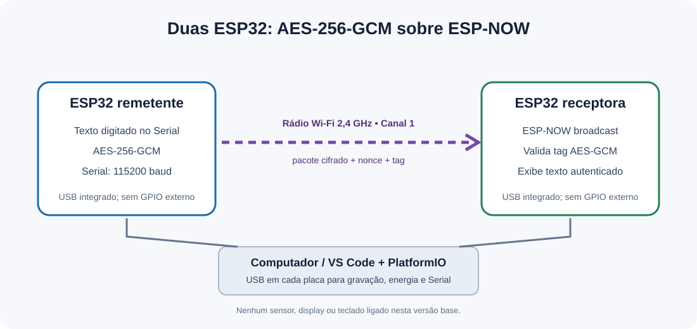

# Duas ESP32, uma mensagem protegida: AES-GCM via ESP-NOW

> Projeto prático de IoT e Segurança da Informação desenvolvido na disciplina de Algoritmos e Estrutura de Dados (CESAR School).

## 👥 Integrantes da Equipe

- João Marcos (jmns@cesar.school / [@sonjoao](https://github.com/sonjoao))
- Luiz Neto (lcbn@cesar.school / [@luizzzxt](https://github.com/luizzzxt))

---

## 📖 1. Contexto e História (O Problema)

Mensagens de telemetria e comando entre dispositivos IoT podem ser lidas ou alteradas se forem transmitidas sem proteção. Este protótipo demonstra duas ESP32 trocando mensagens curtas por ESP-NOW, com confidencialidade e verificação de integridade/autenticidade fornecidas pelo AES-256-GCM. Se a etiqueta de autenticação não validar, o receptor descarta a mensagem.

O projeto é uma demonstração didática. A chave é compartilhada manualmente entre as placas e a camada ESP-NOW usa broadcast; não há provisionamento seguro, proteção contra repetição (replay), gerenciamento de chaves ou garantia de entrega. Não use esta configuração em um produto ou ambiente real.

## ⚙️ 2. Funcionalidades do Dispositivo

- [x] Cifragem AES-256-GCM no remetente antes do envio.
- [x] Transporte sem roteador usando ESP-NOW em canal fixo.
- [x] Verificação da etiqueta GCM e descarte de pacote adulterado no receptor.
- [x] Entrada da mensagem e saída do resultado pelo Monitor Serial.
- [ ] Teste em bancada com duas placas físicas e registro em vídeo — executar e anexar após a montagem.
- [ ] Anti-replay e provisionamento seguro de chaves — fora desta versão demonstrativa.

## 🛠️ 3. Especificações Técnicas e Componentes

- **Microcontrolador:** duas placas ESP32 Dev Module/ESP32-WROOM-32 compatíveis com `esp32dev` (confirmar o modelo real das placas).
- **Sensores e interfaces:** rádio Wi-Fi 2,4 GHz usado pelo ESP-NOW; interface USB/Serial. Teclado e display não fazem parte desta versão base.
- **Ambiente de desenvolvimento:** Visual Studio Code com extensão PlatformIO.
- **Framework:** Arduino para ESP32, linguagem C++.
- **Criptografia:** AES-256-GCM via mbedTLS incluído no framework ESP32.

## 🔌 4. Diagrama de Conexões (Pinout)

A versão atual não liga sensores, teclado ou display a GPIOs. Cada placa conecta-se ao computador ou à fonte USB pelo conector integrado. As mensagens seguem sem fio entre as placas; nenhum fio entre GPIOs é necessário.



| Componente | Pino do componente | Pino no ESP32 | Observações |
| :--- | :--- | :--- | :--- |
| ESP32 remetente | USB | Conector USB da placa | Gravação e Monitor Serial; alimentação |
| ESP32 receptora | USB | Conector USB da placa | Gravação e Monitor Serial; alimentação |
| ESP-NOW | Rádio 2,4 GHz | Rádio integrado | Canal 1, broadcast; sem conexão física |

**Atenção:** confira o modelo e a pinagem da placa recebida. Não conecte componentes externos sem um diagrama específico para eles.

## 🚀 5. Instruções de Compilação e Gravação

1. Instale o Visual Studio Code e a extensão PlatformIO IDE.
2. Abra esta pasta no VS Code. O PlatformIO instala a plataforma definida em `platformio.ini` na primeira compilação.
3. Crie/ajuste `include/secrets.h` a partir de `include/secrets.example.h`. Troque a chave por 32 bytes aleatórios e use exatamente a mesma chave nas duas placas. O arquivo `secrets.h` é ignorado pelo Git.
4. Conecte a primeira placa via cabo USB de dados e selecione a porta serial. Em algumas placas é necessário manter BOOT durante o início do upload.
5. Para a placa remetente, compile e grave o ambiente **esp32_sender**.
6. Para a segunda placa, grave o ambiente **esp32_receiver**.
7. Mantenha as placas próximas, ambas no canal 1. Abra o Monitor Serial de cada uma a 115200 baud.
8. Digite uma linha no Monitor Serial do remetente. O receptor deve imprimir a mensagem somente após autenticação bem-sucedida.

CLI opcional, executada na raiz do projeto:

```bash
pio run -e esp32_sender
pio run -e esp32_receiver
pio run -e esp32_sender -t upload --upload-port COM5
pio run -e esp32_receiver -t upload --upload-port COM6
pio device monitor --port COM5 --baud 115200
```

Troque `COM5` e `COM6` pelas portas exibidas no seu computador. Para testar a detecção de adulteração, altere deliberadamente um byte do ciphertext/tag em uma bancada de teste e confirme que o receptor mostra falha de autenticação; não faça isso em uma demonstração normal.

## 🎥 6. Demonstração em Bancada

Ainda precisa ser gravada com as placas físicas. Sugestão para um vídeo de 1–2 minutos:

1. Mostre as duas placas e a gravação dos ambientes remetente/receptor.
2. Mostre o MAC e a inicialização no Monitor Serial.
3. Digite uma mensagem no remetente e mostre o texto autenticado no receptor.
4. Se houver tempo, demonstre o descarte após falha de autenticação.

**Status:** não há vídeo anexado nesta pasta; atualizar este item depois da gravação.

## 📂 Estrutura

```text
platformio.ini                 Configuração dos ambientes remetente/receptor
src/main.cpp                   ESP-NOW, AES-GCM e interface Serial
include/secrets.example.h      Modelo de chave de demonstração
include/secrets.h              Chave local; ignorada pelo Git
diagramas/arquitetura.svg      Diagrama lógico/conexão
docs/ARTIGO_HACKSTER.md       Rascunho do artigo final
```

## 📚 Referências e segurança

- O guia fornecido para o projeto descreve duas ESP32, AES-GCM, ESP-NOW e o Monitor Serial como interface inicial; recomenda identificar o modelo da placa e não conectar acessórios sem esquema.
- AES-GCM autentica os dados cifrados, mas este protótipo não rejeita mensagens repetidas nem oferece proteção de chave em repouso.
- Nunca publique a chave real. O arquivo `include/secrets.h` está no `.gitignore`; revise o histórico do repositório caso uma chave verdadeira já tenha sido versionada.

